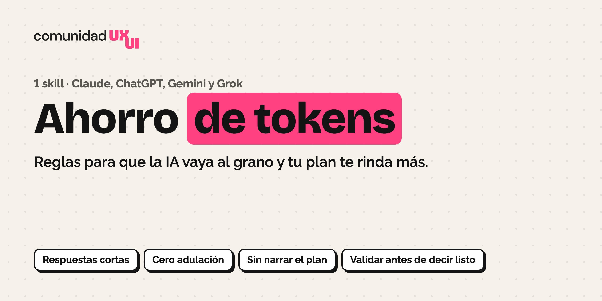

<p align="center"></p>

# Ahorro de tokens

**Reglas para que la IA vaya al grano y tu plan te rinda más:** respuestas cortas, cero adulación, sin contarte el plan antes de hacerlo y sin repetir lo que ya dijiste.

[](LICENSE)
[](skills/)
[](#en-claude-code)
[](#)

---

## Qué resuelve

Cada «¡Excelente pregunta!» y cada párrafo que repite tu pedido consume parte de tu límite de uso. Con estas reglas, la misma conversación te dura más. Incluye la skill para Claude y la versión lista para pegar en ChatGPT, Gemini y Grok.

## Las reglas

1. No programar sin contexto: leer antes de escribir.
2. Respuestas cortas, sin repetir lo que dijiste.
3. Editar solo lo necesario, sin reescribir archivos enteros.
4. Validar antes de decir «listo».
5. Cero adulación.
6. No narrar el plan antes de hacerlo.
7. Hacer en paralelo las lecturas independientes.
8. No duplicar en la respuesta lo que ya está en el archivo.
9. No lanzar subagentes cuando una búsqueda simple alcanza.

El detalle está en [`SKILL.md`](skills/ahorro-de-tokens/SKILL.md).

## Instalación

### En claude.ai y en Cowork

1. Descarga `ahorro-de-tokens.zip` desde **[Releases](https://github.com/CUXUI/ahorro-de-tokens/releases/latest)**.
2. En Claude, entra a **Personalizar → Skills → + → Subir una skill** y súbelo tal como lo descargaste.
3. Abre un chat nuevo y pide lo que necesitas.

Guía paso a paso con capturas: **[cómo subir una skill a claude.ai](NOTION_LINK)**.

### En Claude Code

```
/plugin marketplace add CUXUI/ahorro-de-tokens
/plugin install ahorro-de-tokens@ahorro-de-tokens
```

Después pide lo que necesitas o llama la skill directo: `/ahorro-de-tokens`.

### En Codex, Cursor, Gemini CLI y otros agentes

```bash
npx skills add CUXUI/ahorro-de-tokens
```

Necesita Node.js 22.20 o superior. Si tu agente no instala skills, deja el repositorio en tu carpeta de trabajo y pídele que lea el `SKILL.md` de la carpeta `skills/` y lo siga.

### Como regla fija en Claude Code

Si prefieres que valga siempre, en todos tus proyectos, adjunta [`SKILL.md`](skills/ahorro-de-tokens/SKILL.md) en Claude Code y escribe: *«Agrega estas reglas a mi CLAUDE.md global (~/.claude/CLAUDE.md). Si el archivo no existe, créalo.»*

## En otras IA

### claude.ai, sin instalar nada

En **Configuración → Perfil**, en el campo de preferencias para Claude, o en las **Instrucciones** de un Proyecto:

```
## Reglas de eficiencia
- Respuestas cortas. No repitas lo que ya dije.
- Cero adulación. Nada de "Excelente pregunta" o "Gran idea". Ve directo.
- No narres el plan antes de ejecutar. Haz el trabajo directamente.
- No dupliques código en la respuesta si ya lo editaste o creaste.
```

### ChatGPT

Perfil → **Configuración → Personalización → Instrucciones personalizadas**:

```
- Respuestas cortas y directas. No repitas lo que ya dije en mi mensaje.
- Cero adulación: no uses "Excelente pregunta", "Gran idea", "Perfecto". Ve directo al punto.
- No narres lo que vas a hacer antes de hacerlo ("Voy a explicarte...", "Primero voy a..."). Responde directo.
- Si no tienes contexto suficiente para responder bien, pregunta antes de asumir.
```

### Gemini

Engranaje → **Información guardada** ([gemini.google.com/saved-info](https://gemini.google.com/saved-info)):

```
- Respuestas cortas y directas. No repitas el contexto que ya di.
- Sin cumplidos ni frases de relleno tipo "Excelente" o "Gran idea". Ve al grano.
- No expliques el plan antes de responder. Solo responde.
- Si falta contexto para responder bien, pregunta en vez de asumir.
```

### Grok

Foto de perfil → **Configuración → Personalizar**:

```
- Directo al grano, sin "Excelente pregunta" ni relleno.
- Respuestas cortas.
- No cuentes el plan antes de responder. Solo responde.
- Si falta contexto, pregunta antes de asumir.
```
---

## Usa la IA con criterio

Ahorrar tokens es el comienzo. Usar la IA con criterio en tu trabajo de diseño es lo que practicamos en **[Comunidad UX/UI](https://www.skool.com/comunidaduxui/about)**.

¿Prefieres empezar por correo? Suscríbete a **[Minuto UX](https://comunidad-uxui.kit.com/fb40f8e711)**, el newsletter de Comunidad UX/UI.

**Más skills de Comunidad UX/UI:** [Auditoría UX con IA](https://github.com/CUXUI/auditoria-ux-con-ia) · [Diseño guiado con IA](https://github.com/CUXUI/diseno-guiado-con-ia) · [Excalidraw UX](https://github.com/CUXUI/excalidraw-ux) · [Crea tu asesor](https://github.com/CUXUI/crea-tu-asesor) · [Modo Fable](https://github.com/CUXUI/modo-fable)

## Licencia

[CC BY-NC-SA 4.0](LICENSE). Puedes usarla, adaptarla y compartirla citando a Comunidad UX/UI, sin uso comercial y con la misma licencia.
